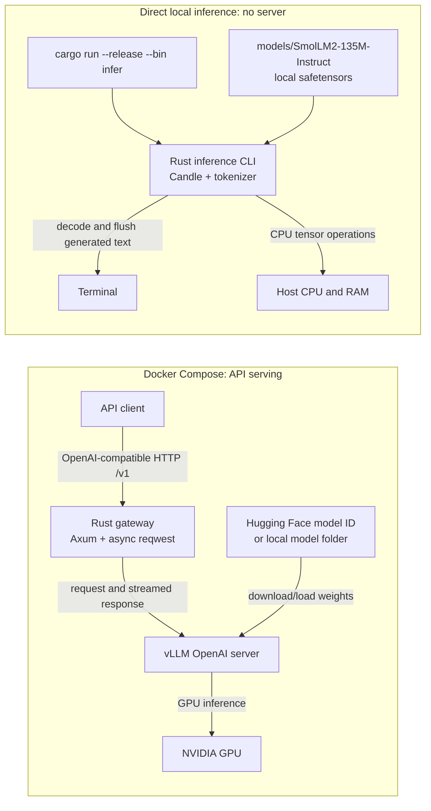

# rusty_inference

A small, asynchronous Rust API gateway in front of [vLLM](https://docs.vllm.ai/). vLLM runs the model on the GPU and provides its OpenAI-compatible inference API; Rust handles the client-facing HTTP API, health checks, optional bearer-key protection, and streaming proxy without buffering generated tokens.

> vLLM is the inference engine, not a Rust library. Its CUDA/Python runtime is packaged as the official vLLM container; the gateway and API layer are Rust.

## What is included

- OpenAI-compatible `/v1/*` passthrough, including chat completions, completions, embeddings, and other endpoints enabled by the vLLM version/model.
- Streaming responses (for example `stream: true`) are forwarded as they arrive.
- `/health` checks the Rust process; `/ready` checks the vLLM backend; `/metrics` proxies vLLM's Prometheus metrics.
- Optional `API_KEY` bearer-token protection on `/v1/*` and `/metrics`.
- Docker Compose deployment with persistent Hugging Face cache, local model mounts, GPU reservation, and vLLM health checks.
- Tests covering proxying, streaming headers, readiness, backend failures, and API-key enforcement.

## Architecture



The serving path and direct local path are separate ways to run inference. In the serving path, Rust accepts and streams API requests while vLLM performs model inference. In the local path, the Rust `infer` executable loads the local model itself with Candle and runs one prompt directly on the CPU.

## Requirements

- Docker Engine with Docker Compose v2.
- NVIDIA GPU, compatible host driver, and NVIDIA Container Toolkit for GPU inference.
- A model that fits the available GPU memory. CPU-only use is possible with a separately configured vLLM image/runtime, but is not the default deployment.

## Run with Docker Compose

```bash
cp .env.example .env
# Edit MODEL and other settings in .env if needed.
docker compose up --build
```

By default, the stack downloads `Qwen/Qwen3-0.6B` from Hugging Face into the persistent `hf-cache` volume and serves it as `assistant` on `http://localhost:8080`. First startup can take several minutes while model files download and load. Choose a model or quantized variant that fits your GPU.

### Use a Hugging Face model ID

Set `MODEL` in `.env` to a model repo ID, for example:

```dotenv
MODEL=Qwen/Qwen3-0.6B
SERVED_MODEL_NAME=assistant
HF_TOKEN=
```

For gated/private repositories, set `HF_TOKEN` to a Hugging Face access token with permission to download that model. Keep `.env` private; it is ignored by git.

### Use a model already downloaded locally

Set `MODEL_DIR` to the host directory containing the model folder and `MODEL` to its path inside the container:

```dotenv
MODEL_DIR=/absolute/path/to/models
MODEL=/models/my-local-model
SERVED_MODEL_NAME=assistant
```

The model directory is mounted read-only. The model folder should contain the standard Hugging Face model files (configuration, tokenizer, and weights). For example, `/absolute/path/to/models/my-local-model/config.json` must exist on the host.

Set `TENSOR_PARALLEL_SIZE` to the number of GPUs across which the model should be sharded. Ensure that the model and vLLM configuration support the selected number.

## API examples

Without a configured gateway key:

```bash
curl http://localhost:8080/v1/chat/completions \
  -H 'Content-Type: application/json' \
  -d '{
    "model": "assistant",
    "messages": [{"role": "user", "content": "Explain Rust ownership in one sentence."}],
    "temperature": 0.2,
    "max_tokens": 128,
    "stream": true
  }'
```

With `API_KEY` set in `.env`, add:

```bash
set -a
. ./.env
set +a
curl http://localhost:8080/v1/chat/completions \
  -H 'Content-Type: application/json' \
  -H "Authorization: Bearer ${API_KEY}" \
  -d '{"model":"assistant","messages":[{"role":"user","content":"Hi"}]}'
```

The exact model name in requests is the `SERVED_MODEL_NAME` value. Other supported endpoints are forwarded unchanged, for example:

```bash
curl http://localhost:8080/v1/models
curl http://localhost:8080/v1/embeddings \
  -H 'Content-Type: application/json' \
  -d '{"model":"assistant","input":"A short example sentence."}'
curl http://localhost:8080/health
curl http://localhost:8080/ready
curl http://localhost:8080/metrics
```

Availability of embeddings, audio, pooling, reranking, and other vLLM endpoints depends on the selected vLLM release and model. This gateway forwards `/v1/*` requests without changing their JSON schema.

## Run the Rust gateway locally

If vLLM is already running on port `8000`, install Rust (edition 2024 support) and run:

```bash
VLLM_BASE_URL=http://127.0.0.1:8000 cargo run --release
```

Configuration:

| Variable | Default | Description |
|---|---|---|
| `PORT` | `8080` | Rust gateway listen port |
| `VLLM_BASE_URL` | `http://127.0.0.1:8000` | Base URL of the vLLM OpenAI-compatible server |
| `API_KEY` | unset | Optional bearer token required by the gateway |
| `CONNECT_TIMEOUT_SECS` | `5` | Timeout for establishing backend connections |

Inference response bodies do not have a total-duration timeout, so long generations and SSE streams can complete normally.

## How Rust, Cargo, and concurrent requests work

Rust is the language used for both the gateway and the direct inference CLI. Cargo is Rust's build, dependency, and run tool; it is not a hosting or deployment service:

- `cargo run --release --bin infer -- ...` compiles and runs the standalone inference executable locally.
- `cargo run --release` compiles and runs the gateway locally, assuming vLLM is already reachable.
- `docker compose up --build` builds a Rust gateway image and starts it with the vLLM container. This is the provided deployment setup; it only becomes deployed/running when you execute it on a machine with Docker and the required inference hardware.

The Axum gateway can handle multiple HTTP requests concurrently, and its shared async HTTP client streams each request to vLLM without buffering the full response. The gateway currently has **no explicit inference concurrency limit or queue**. `pool_max_idle_per_host(128)` configures how many idle backend connections may be reused; it is not a limit of 128 active inference requests.

For the API path, vLLM schedules and batches simultaneous inference requests. How many it can serve efficiently depends on its version/configuration, model size and precision, prompt/context lengths, generation limits, GPU compute, and GPU memory—especially the KV cache used to retain attention state for active sequences. This repository leaves vLLM's scheduling limits at its defaults; `TENSOR_PARALLEL_SIZE` controls how a model is split across GPUs, not the number of concurrent requests. For production traffic, configure vLLM's sequence/token limits for the deployed version and consider adding gateway admission control or a request queue.

The direct `infer` CLI is different: it handles one prompt per process, token by token. The current CLI uses the CPU, so GPU RAM is not its limiting resource; host RAM, compute speed, model weights, context size, and the KV cache matter. Starting multiple CLI processes can run multiple prompts, but each process loads its own model and cache and competes for system memory/CPU.

### Run the local model directly in Rust

The local SmolLM2 model can also run entirely in Rust with Candle on CPU; this does not use Python or vLLM:

```bash
cargo run --release --bin infer -- \
  --model models/SmolLM2-135M-Instruct \
  --prompt "What is 2 + 2? Reply with only the number." \
  --max-new-tokens 24
```

The default model path is the repository's `models/SmolLM2-135M-Instruct` folder. Tokens are decoded and flushed to the terminal as generation proceeds; the final incomplete word/punctuation is flushed when generation ends. Rust dependencies are downloaded and compiled on the first run; the tokenizer dependency requires a C++ compiler. The downloaded weights stay local and Git-ignored.

## Local Hugging Face inference (CPU)

For a lightweight local smoke test that does not require vLLM or a GPU, the repository can use the `HuggingFaceTB/SmolLM2-135M-Instruct` model (135 million parameters). The Python Conda environment is named `rusty_inference`; use CPU PyTorch when the host GPU runtime is unavailable:

```bash
conda create --override-channels -c conda-forge -n rusty_inference python=3.11 pip -y
conda run -n rusty_inference python -m pip install torch --index-url https://download.pytorch.org/whl/cpu
conda run -n rusty_inference python -m pip install transformers huggingface_hub safetensors
```

Download the model into the Git-ignored `models/` directory:

```bash
conda run -n rusty_inference hf download HuggingFaceTB/SmolLM2-135M-Instruct \
  config.json generation_config.json model.safetensors special_tokens_map.json \
  tokenizer.json tokenizer_config.json vocab.json merges.txt \
  --local-dir models/SmolLM2-135M-Instruct
```

Run local inference using the downloaded model:

```bash
conda run -n rusty_inference python scripts/infer.py \
  --prompt "What is 2 + 2? Reply with only the number."
```

The script loads only from the local model folder, runs generation on CPU, and prints the generated answer. The first download and inference require internet only for downloading model files; subsequent runs can use the local copy. Model files are excluded from Git by `.gitignore`.

## Tests

```bash
cargo fmt --check
cargo test
```

Tests use a local mock HTTP backend and do not download a model or require a GPU.

## Deployment notes

- Only the Rust gateway port is published by Compose; vLLM is reachable only on the private Compose network.
- Set a strong `API_KEY` before exposing the gateway beyond a trusted local network. Terminate TLS at a reverse proxy/load balancer for remote clients.
- Pin `VLLM_IMAGE` to a tested version for reproducible production deployments instead of tracking `latest`.
- Model performance depends on GPU, vLLM version, model, quantization, context length, and concurrency; the gateway does not claim a fixed throughput.
